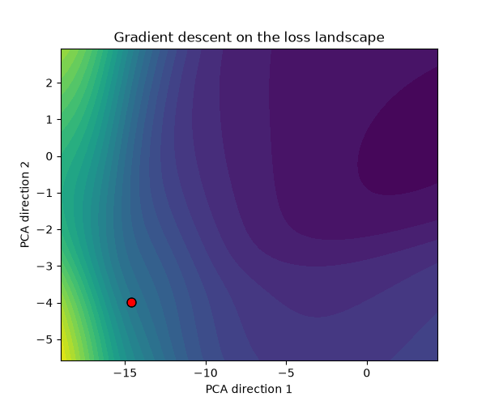
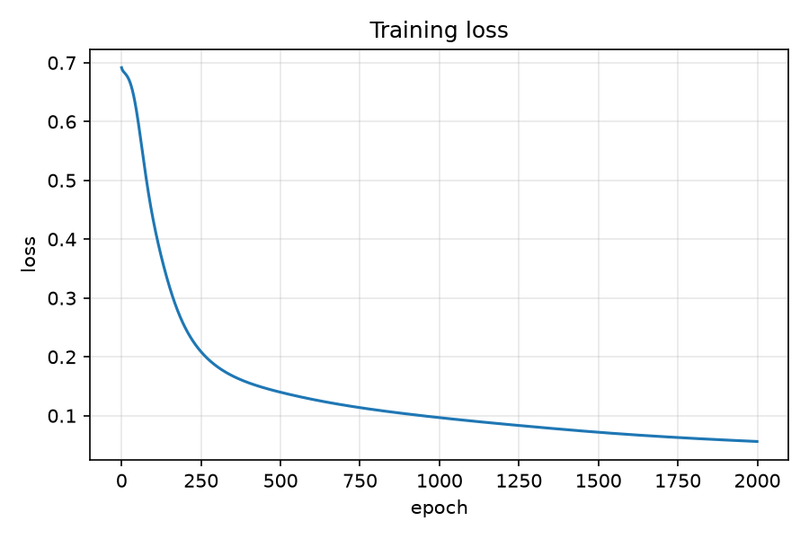
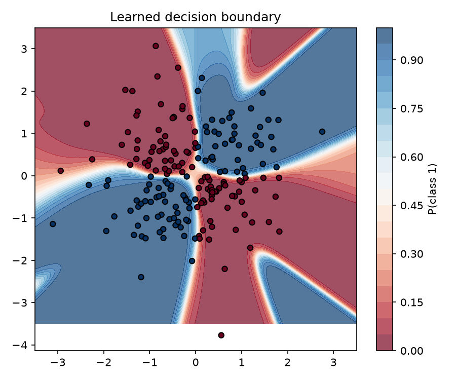
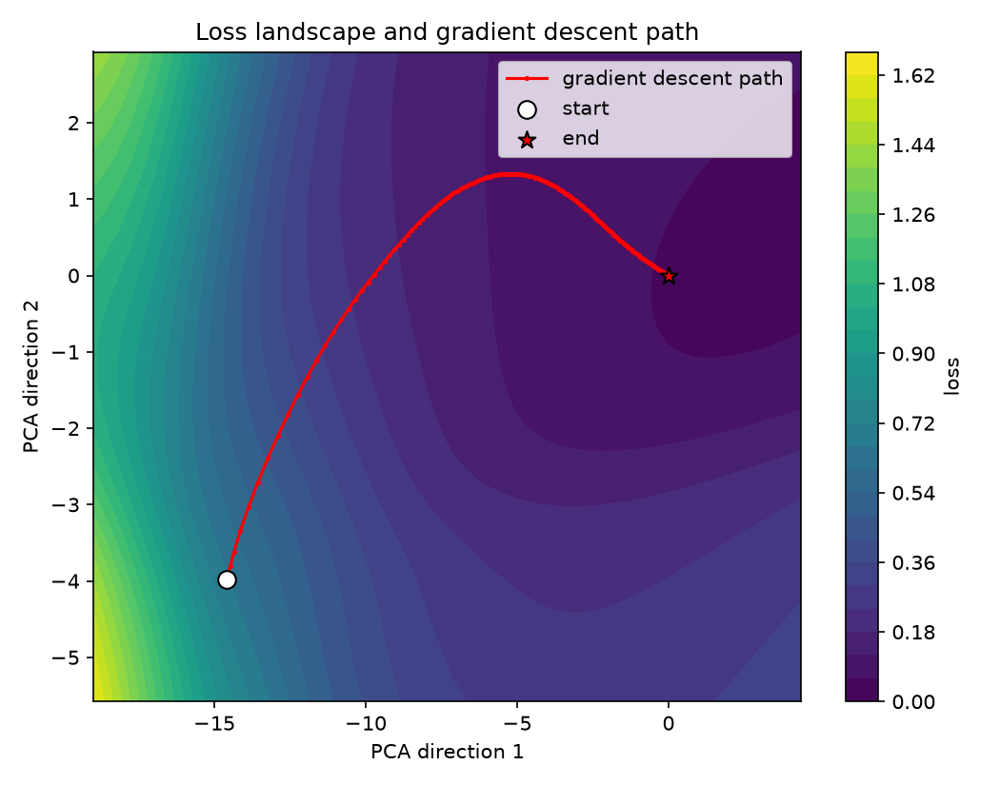
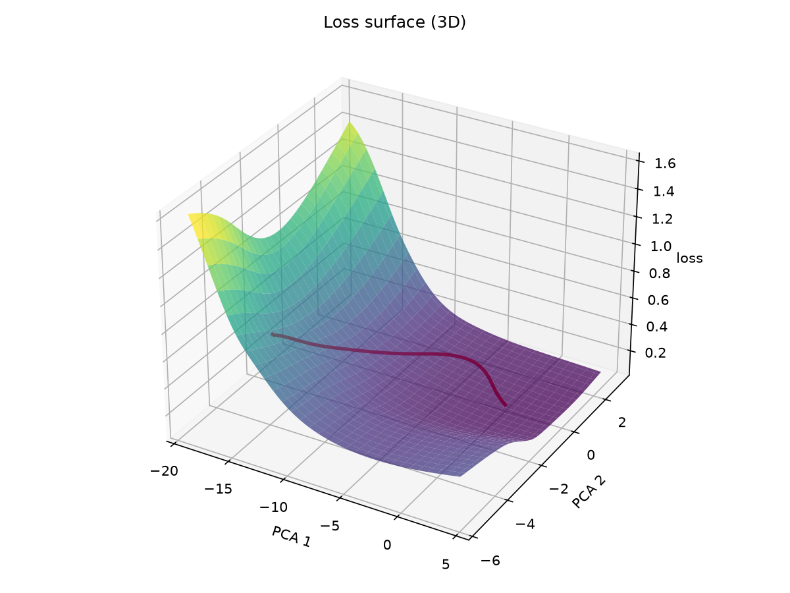
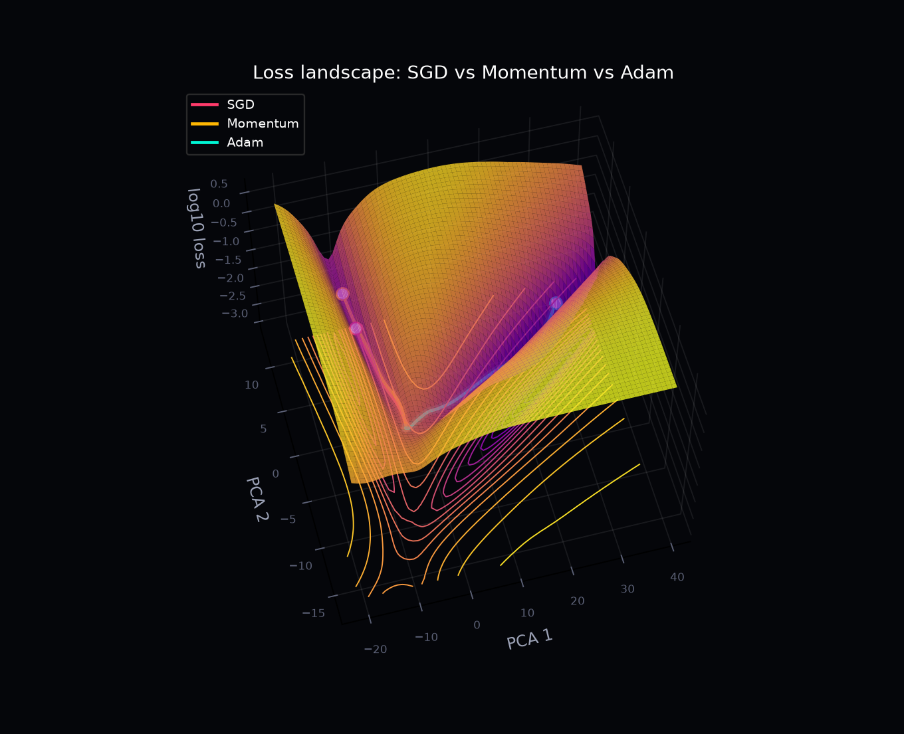
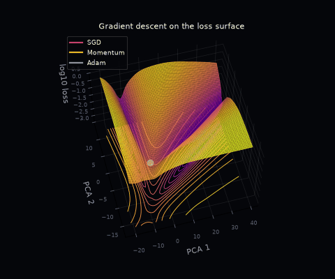
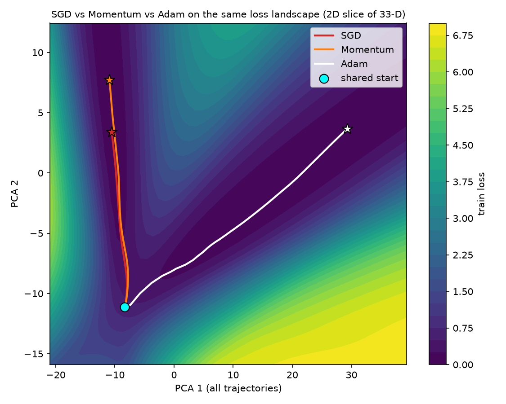
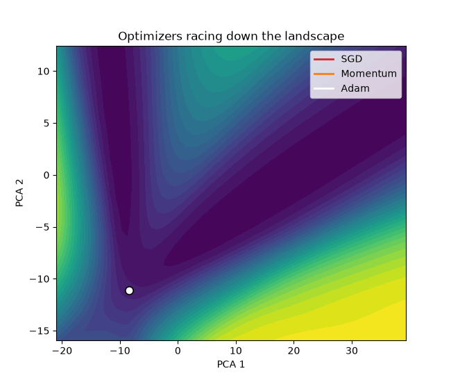

# Neural Network from Scratch (NumPy)

A 2-layer neural network built in pure NumPy: manual backpropagation, a numerical gradient check,
and a visualization of the loss landscape with the path gradient descent takes through it.
No ML libraries, just NumPy + Matplotlib.

## Run
    pip install -r requirements.txt
    python main.py

This runs everything and saves outputs to `results/`.

## What's inside
| File | Purpose |
|---|---|
| `nn.py` | Data, forward pass, loss, backprop, training loop |
| `gradient_check.py` | Compares backprop to finite-difference gradients (relative error ~1e-9) |
| `plots.py` | Loss curve and decision boundary |
| `landscape.py` | Loss landscape on a 2D plane + gradient descent path + GIF |
| `optim.py` | SGD, Momentum, Adam (NumPy, flat-vector) |
| `compare.py` | Optimizer comparison: shared landscape, held-out test set, 10 seeds |
| `viz_neon.py` | Dark/neon 3D loss surface + orbiting GIF |
| `main.py` | Runs the full pipeline |

## Results
- Task: XOR-like classification (not linearly separable, so a hidden layer is required)
- Architecture: 2 -> 8 (tanh) -> 1 (sigmoid), binary cross-entropy, full-batch gradient descent
- Final accuracy: ~99.5% on the training set (~94% on 1000 unseen points, see below)
- Gradient check: PASS

| Loss curve | Decision boundary |
|---|---|
|  |  |

| Landscape (contour) | Landscape (3D) |
|---|---|
|  |  |

## How the loss landscape works
The network has 33 parameters, so the true loss surface is 33-dimensional. To visualize it, I
take the saved weight trajectory, run PCA to find the 2 directions where the weights moved the
most, and evaluate the loss on a grid in that plane. The gradient descent path is then
projected onto the same plane.

## Neon 3D view

Log-scaled loss surface (2D PCA slice of the 33-D space) with floor contours and the three optimizer paths; `viz_neon.py` also renders an orbiting-camera GIF.

## Optimizer comparison (SGD vs Momentum vs Adam)
Same init, same data, same loss landscape (PCA plane fit on all three trajectories). Stats over 10 seeds, tested on 1000 held-out points.

| Optimizer | Train loss | Test loss | Train acc | Test acc | Epochs to loss<0.1 |
|---|---|---|---|---|---|
| SGD | 0.066±0.018 | 0.133±0.022 | 98.7%±0.8% | 94.2%±1.4% | 1061±445 |
| Momentum | 0.046±0.018 | 0.131±0.026 | 99.4%±0.7% | 94.4%±1.4% | 601±319 |
| Adam | 0.006±0.005 | 0.361±0.175 | 100.0%±0.2% | 93.1%±1.4% | 122±46 |

Findings:
- Adam reaches loss < 0.1 about 9x faster than SGD (~120 vs ~1060 epochs) but ends in a different region of the landscape.
- Adam drives train accuracy to 100% yet has the worst test loss (0.36 vs 0.13) and lowest test accuracy: it overfits the 200 training points with large weights. Faster convergence did not mean better generalization here.
- Momentum is the best trade-off on this task: ~1.8x faster than SGD with equal or better test metrics.
- Caveat: the landscape is a 2D PCA projection of a 33-D surface, and learning rates were set by hand, not tuned per optimizer.

## What I learned
(Write 3-4 sentences in your own words: what surprised you, what bugs you hit,
what you'd try next, e.g. other optimizers, more layers, different data.)

## Ideas to extend
- Compare SGD, momentum, and Adam paths on the same landscape
- Try different hidden sizes or initializations
- Train on MNIST
